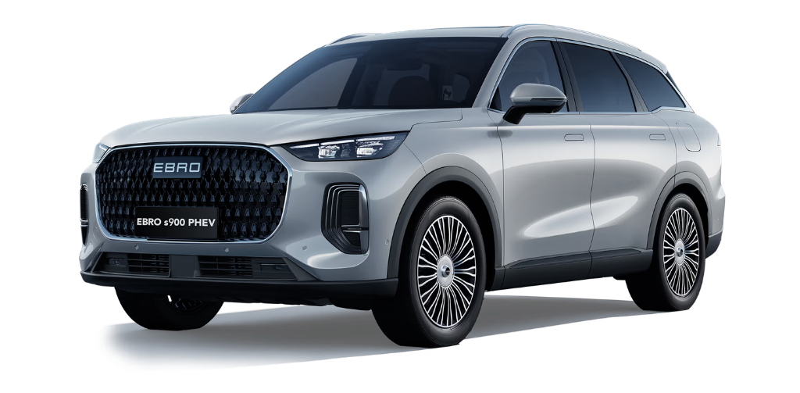

# Ebro Auto — Home Assistant integration

**🌍 Language:** **English** · [Español](README.es.md)

[![HACS Custom][hacsbadge]][hacs]
[![GitHub release][releasebadge]][releases]
[![Validate][validatebadge]][validate]
[![License: MIT][licensebadge]](LICENSE)
[![GitHub stars][starsbadge]][stars]

Monitor and control your **Ebro** car from Home Assistant, without relying on the official app.

> ⚠️ **Unofficial project.** Strictly for personal use, on your own vehicle and your own account.
> Not affiliated with or endorsed by Ebro, Chery or Home Assistant.

<p align="center">
  
</p>

---

## Install

[![Open your Home Assistant instance and open this repository inside HACS.][hacsrepobadge]][hacsrepo]

### Option A — HACS (recommended)

Once the integration is in the HACS default store, just search for **Ebro Auto** in HACS and install it.
Until then, add it as a custom repository:

1. In Home Assistant: **HACS → Integrations → ⋮ menu → Custom repositories**.
2. Add this repository's URL with the **Integration** category.
3. Search for **Ebro Auto**, install it and **restart** Home Assistant.

### Option B — Manual

1. Copy the `custom_components/ebro/` folder into `config/custom_components/`.
2. **Restart** Home Assistant.

---

## Setup

After installing and restarting: **Settings → Devices & services → Add integration → Ebro Auto**.

[![Open your Home Assistant instance and start setting up a new integration.][configflowbadge]][configflow]

### Step 1 — your account

- **Phone number** of your Ebro account, with the country prefix.
- **Password** of the account.
- **PIN** for remote commands: the same one the app asks for to lock or unlock the car.

> ⚠️ **Best with the vehicle owner's account.** With a secondary account everything works except
> one thing: the car does not push notifications to it, so doors, lock and tailgate do not update
> on their own. There is a workaround — see [Secondary accounts](#secondary-accounts) — and the
> integration warns you automatically if it detects this is your case.

There is also an **"Advanced"** dropdown with Ebro's servers and channel. It comes pre-filled with
the correct values for Europe: don't touch it unless you use another region or you are asked to for
diagnostics.

The VIN and the rest of the data are detected automatically on login. Home Assistant keeps the
session and renews it on its own: you won't have to type the password again unless it expires.

Credentials are stored **only in your Home Assistant**. There is no intermediate server.

### Step 2 — how often to poll

The integration asks how often to request the data the car does not push on its own (battery,
range, odometer…). You can change it later in **Configure**. Everything is in **minutes**, and
**0 means do not poll** in that state:

| When the car is… | Default |
|---|---|
| **Parked** | **0 — not polled** |
| **Plugged in** (cable connected, not charging yet) | 30 min |
| **Charging** | 15 min |
| **Driving** | 3 min |
| **Driving, stopped** (traffic light, or you step out with the car on) | 5 min |
| **Plugged-in cap, not charging** (stops polling if the cable never starts charging) | 0 — no limit |

Raising the **Parked** value is perfectly reasonable if you want the numbers to refresh with the
car parked too: polling does not wake the vehicle. See [How data is updated](#how-data-is-updated).

---

## How data is updated

There are **two ways** for a value to reach Home Assistant, and knowing which is which explains why
some things update on their own and others don't.

### 1. What the car pushes on its own

As soon as they change, the car sends them and they appear immediately, even with "Automatic
update" turned off:

- Doors, windows, tailgate, hood, sunroof and **central locking**
- Climate, defrosters, steering wheel and seats: on or off
- **Charging cable** connected and **engine** running

> **With a secondary account, none of this list updates on its own.** The car only pushes
> notifications to the owner's account. See [Secondary accounts](#secondary-accounts).

### 2. What has to be polled

The **numbers** are not pushed by the car; they have to be requested:

- Battery, range, odometer and speed
- Charging voltage, current, time and status
- Tyre pressure and temperature, consumption and warnings

And here is the key point: **when the integration polls, it asks the Ebro cloud, not the car**. The
cloud stores the last state the vehicle reported, and that is what it returns. With the car awake
that state is seconds old; with the car parked and asleep it may be a while old, because while it
sleeps it reports nothing new.

The **"Location probe result"** sensor tells you how the last poll went:

| State | What it means |
|---|---|
| 🟢 Live · car awake | The car is connected; the data is from right now |
| 🟡 State from cloud · N min ago · car asleep | The car is asleep; this is the latest the cloud stored, and from when |
| 🟠 Data, no position | Telemetry arrived, but the cloud has no recent location. Solved with "Locate car (GPS)" |
| 🔴 No data · … | The cloud returned nothing, with the reason |
| ⏳ Recent read · waiting N s | Just polled; it waits a bit before retrying |
| 🔑 Session expired · re-authenticate | You need to log in again |
| 🛰️ Polling… | In progress; takes a moment |

Position gets its own row because it may be missing even when the rest arrives: the cloud only has
it if the car reported it. If you need it right now, "Locate car (GPS)" requests it.

### Polling does not wake the car

Only **commands** wake it: lock, unlock, climate, "Locate car (GPS)"… Polling asks the vehicle for
nothing, so you can adjust the intervals with peace of mind.

The only exception is the **"Full status refresh"** button: it turns the climate on for a minute on
purpose, because that is the only way to read real battery and odometer with the car cold. It is by
far the most power-hungry: use it sparingly.

Hence also the difference between the two location buttons: **"Update location"** fetches the last
position known to the cloud, while **"Locate car (GPS)"** makes the car report where it is right now.

### Automatic polling

It is controlled by the **"Automatic update"** switch, and the pace changes with what the car is
doing:

- **Plugged in and Charging:** detected by the cable and by whether current is flowing. Plugged in
  polls slowly and, when it actually starts charging, switches to the charging pace.
- **Driving:** while moving, the car sends notifications very frequently; that, with the high-voltage
  traction system on, is what the integration reads as "driving". If they stop arriving but the car
  is still on (a traffic light, or you step out without turning it off), it switches to "driving,
  stopped".
- **Parked:** the car fully off. If you leave that interval at 0, nothing is polled until the car
  gives signals again.

With the car cold no poll gets real battery or odometer, no matter how low you set the intervals:
the car needs to be on.

---

## Scheduled charging

The **start time** and **duration** show the schedule the car has, and you can change them from
Home Assistant. You set the time in your **local time**; the conversion is done automatically. The
duration is an **HH:MM** selector, so you can set, for example, 02:15.

Changing them **does not send them on its own**: press **"Apply scheduled charging"** (or toggle the
"Scheduled charging" switch on again) to send them to the car.

The **"Scheduled charging on the car"** sensor shows what is set on the vehicle, even if you changed
it from the official app: the time, whether it is on and which days it applies.

## Scheduling charging from an automation

The time and duration entities **store a preference**: they send nothing to the car until you press
"Apply scheduled charging". This is on purpose — so moving a control by accident doesn't issue
commands to the car.

For automations there is one action that does it all at once:

```yaml
action: ebro.programar_carga
target:
  entity_id: switch.ebro_XXXX_carga_programada
data:
  hora_inicio: "02:00:00"
  duracion: 240        # minutes (minimum 60: the car rejects less)
  activar: true
```

Useful, for example, to charge during the cheapest electricity hours without chaining three calls
and relying on their order.

**To stop a charge in progress** use the **"Stop charging"** button. Turning the scheduled-charging
switch off only disables the schedule; it does not stop a charge already underway.

This car **does not allow starting or stopping charging directly** (its "Charge Control" permission
is denied from the factory), so "Stop charging" achieves it by imposing a schedule whose window has
already ended. It works, but takes a few seconds to take effect.

## Charge limit

The car has no charge cap, so the integration does it on its own:

1. Turn on **"Limit charge to percentage"** and pick the **"Charge limit (%)"**, for example 80.
2. While charging, the integration watches the battery and stops the charge when the target is reached.

Keep in mind that:

- It needs **"Automatic update" on** and the **"Charging" interval greater than 0**: that is what
  lets it watch the battery. The integration won't let you turn the limit on if either is missing,
  and tells you which; and if you remove one of the two afterwards, the limit turns off on its own
  — so you are not left with a switch that is on but doing nothing.
- Near the target it polls more often to fine-tune the cutoff, but it can still overshoot by
  **1–2%** depending on how fast it is charging.

---

## Secondary accounts

If you use a **secondary account** — one the car owner has granted access to — there is a difference
worth knowing. The integration detects it on its own and warns you in **Settings → Repairs**.

**Works normally:** polling the status, battery, range, position, and all commands — lock, unlock,
climate, tailgate, windows.

**Does not work:** the car **does not push notifications on its own** to secondary accounts. Doors,
lock and tailgate do not update by themselves.

This is a limitation of the Ebro server, not of this integration: the **official app doesn't receive
those notifications either** with a secondary account. What it does to seem instant is **ask every
few seconds**.

**To make the states update on their own**, you can do the same: in the integration options, set a
non-zero value in **"Poll while parked"**. The lower it is, the sooner a change is reflected — and
the more requests are made to the Ebro cloud. Bear in mind the app only asks while open on screen,
and Home Assistant would do it around the clock.

**With the owner's account** none of this is needed: notifications arrive on their own.

---

## Dashboard card (recommended)

For a complete view of the car — vehicle image, ranges, tyres, access, climate, charging and map —
the **Vehicle Status Card** by [@ngocjohn](https://github.com/ngocjohn/vehicle-status-card) works
very well. Install it from **HACS → Frontend → Custom repositories**, with the *Dashboard* category.

This repository has a ready-made config to adapt:
**[`examples/vehicle-status-card.yaml`](examples/vehicle-status-card.yaml)**.

1. Copy its content into a manual card: **Edit dashboard → Add card → Manual**.
2. **Replace `XXXX`** with the **last four digits of your car's VIN** (find and replace `ebro_XXXX_`
   with `ebro_1234_`).
3. The **car image** is chosen in the card's UI; in the YAML it is marked as
   `[ENLACE A IMAGEN LOCAL. CONFIGURAR EN GUI DE TARJETA]`. In `examples/` you have `S900_General.png`
   and `S900_Top.png` (top-down view, for the tyres).

---

## Privacy

All traffic goes directly between your Home Assistant and the Ebro/Chery servers, and your
credentials never leave your installation.

## Credits

Based on the excellent work of
**[omoda9-ha](https://github.com/Caslinovich/omoda9-ha)**, adapted to the **Ebro** brand.

## License

MIT — see [LICENSE](LICENSE).

<!-- Badges -->
[hacs]: https://github.com/hacs/default
[hacsbadge]: https://img.shields.io/badge/HACS-Custom-41BDF5.svg
[releases]: https://github.com/jcortizronda/ebroAuto_homeAssistant/releases
[releasebadge]: https://img.shields.io/github/v/release/jcortizronda/ebroAuto_homeAssistant
[validate]: https://github.com/jcortizronda/ebroAuto_homeAssistant/actions/workflows/validate.yml
[validatebadge]: https://img.shields.io/github/actions/workflow/status/jcortizronda/ebroAuto_homeAssistant/validate.yml?branch=main&label=validate
[licensebadge]: https://img.shields.io/github/license/jcortizronda/ebroAuto_homeAssistant
[stars]: https://github.com/jcortizronda/ebroAuto_homeAssistant/stargazers
[starsbadge]: https://img.shields.io/github/stars/jcortizronda/ebroAuto_homeAssistant?style=flat
[hacsrepo]: https://my.home-assistant.io/redirect/hacs_repository/?owner=jcortizronda&repository=ebroAuto_homeAssistant&category=integration
[hacsrepobadge]: https://my.home-assistant.io/badges/hacs_repository.svg
[configflow]: https://my.home-assistant.io/redirect/config_flow_start/?domain=ebro
[configflowbadge]: https://my.home-assistant.io/badges/config_flow_start.svg
